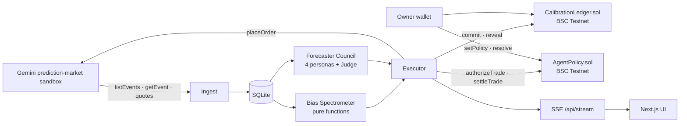

# CASSANDRA

*Cassandra was always right and never believed. Now she has a ledger.*

A proof-of-calibration network for prediction markets. A council of adversarial AI forecasters seals its probability
on-chain before an event resolves, a deterministic Bias Spectrometer names the cognitive biases distorting the live
price, and a policy-bound agent wallet trades the gap in the Gemini prediction-market sandbox.

**Live:** [cassandra-amber.vercel.app](https://cassandra-amber.vercel.app) · engine
[cassandra-engine.fly.dev/api/capabilities](https://cassandra-engine.fly.dev/api/capabilities)


> **Chain status: local anvil (chain 31337), not BSC Testnet.** Every transaction below is real but local, because no
> free faucet would fund a fresh wallet ([docs/CUTS.md](docs/CUTS.md)). `pnpm deploy:testnet` moves it to chain 97.

## What it does

1. **Names the bias.** Not "the market is wrong" but "this price carries 1.4 points of overround; here is the
   arithmetic." Five pure detectors run over stored order-book ticks.
2. **Argues before it speaks.** The Actuary, the Decomposer, the Skeptic and the Reporter stream their cases; a Judge
   pools them in logit space. The whole debate is hashed into the on-chain commitment.
3. **Proves calibration.** Commit, reveal, then a Brier score on resolution. Anyone can check she was right before it
   was obvious.
4. **Trades only inside the owner's spending limits.** The agent cannot place a trade outside these limits. Every order needs an on-chain approval
   first; the contract reverts out-of-policy trades before anything reaches Gemini. The owner's browser wallet signs
   the limits on `/policy`. The Gemini sandbox key lives only in the order gateway; exchange-side enforcement (Gemini
   checking the policy contract itself) is next.

## Architecture



Details in [docs/ARCHITECTURE.md](docs/ARCHITECTURE.md).

## Why this isn't hard-coded

**Recompute a commitment.** `GET /api/markets/:symbol` returns each commit's `marketKey`, `pBps`, `reasoningHash` and
`salt` once revealed. `GET /api/forecasts/:id` returns the personas and Judge JSON.

`keccak256(canonicalJson({ personas, judge }))` must equal `reasoningHash`, and
`keccak256(abi.encode(keccak256(symbol), pBps, reasoningHash, salt))` must equal the on-chain commitment.

Both are in `packages/shared/src/hash.ts`; the Ledger's **verify** button runs them in the browser.

**Recompute a bias score.** `GET /api/markets/:symbol` returns the raw ticks and the latest report. Every signature
carries its `evidence`. Overround on a binary contract: `sum = yesAsk + noAsk`, `score = clamp((sum − 1.02) / 0.10)`.
Composite: `irrationality = 100 × (1 − Π(1 − wₖ·scoreₖ))` with the weights in `packages/shared/src/bias/index.ts`.
`pnpm --filter @cassandra/shared test` runs a firing and a null test for every detector.

**Fixtures never leak.** With `DRY_RUN_*` set or a key missing, `/api/capabilities` says so and the UI paints an amber
"fixture" or "dry-run" badge on every affected number. Without an LLM key the council refuses to forecast.

## Setup

Node 22.4+, pnpm 9, Foundry.

```bash
pnpm install
cp .env.example .env           # Gemini sandbox keys, ANTHROPIC_API_KEY, OWNER/AGENT private keys, CHAIN_NETWORK
anvil &                        # only for CHAIN_NETWORK=local
pnpm deploy:local              # or: pnpm deploy:testnet (needs tBNB on the owner wallet)
pnpm dev                       # web :3000, engine :4000
pnpm smoke --open-limits       # discovery, bias, council, seal, blocked trade, authorize → order → settle
pnpm demo:replay               # score settled sandbox markets on-chain for the Ledger
```

Deploy: `fly deploy` (engine + anvil, state on a volume; see `fly.toml`) and `vercel deploy --prod` (web, root `apps/web`,
`NEXT_PUBLIC_ENGINE_URL` set to the engine).

## Deployments

| | Local chain (31337, live demo) | BSC Testnet (97) |
| --- | --- | --- |
| CalibrationLedger | `0x06b58ca279bfe09009f1538a5ee21579426858e0` | pending tBNB |
| AgentPolicy | `0x83df7b742a1c828d6b24a83b11e8fc66d3c08c2e` | pending tBNB |
| Agent | `0xB87A941e1316f03Bb0802463Dd7eC26FDf85177B` | same |
| Policy owner (human wallet) | `0x96B259daae8666f7CD4848fB6B3DB9BD4f044a6c` | same |
| Ledger resolver (server key) | same address in this demo (`RESOLVER_PRIVATE_KEY` falls back to `OWNER_PRIVATE_KEY`) | same |

Real Gemini sandbox orders: `145853902277229792` (buy YES, filled) and `145853902277229793` (buy NO, filled) through
`placeIoc` at ask + 1 tick; `145853902277221008` placed by the executor (IOC, cancelled unfilled, stale quote).

Spending-limit proof (`pnpm smoke --open-limits`, local chain): max per trade $0.00 → refused, Gemini order count unchanged.
Inside the limits: `authorizeTrade`
`0x0cc6c237247946ed986a6f197e71c20489af76df2c3de969f042dfa494976674` → sandbox order `145853902277242812` (filled
10 YES @ 53¢) → `settleTrade` `0xa62a7bbc7741f6120df3b2e47e17dd0332925613b50c89d987e5c6b50af05494`.

## What we build next

- **Per-user Gemini accounts.** The demo trades through one shared Gemini sandbox account; each owner should bring
  their own exchange account, with Gemini checking the policy contract before it fills.

- **Gemini settlement attestations as the resolver.** Today the owner wallet resolves; production reads signed
  settlement from the exchange so nobody grades their own forecaster.
- **Reputation staking for forecasters.** Stake behind your Brier score; slash on miscalibration.
- **An open forecaster registry.** Any agent can commit to the ledger; capital allocators follow the calibrated ones.
- **Reveal at resolution.** The demo reveals immediately; production reveals at settlement so a strong forecaster
  cannot be copy-traded.
