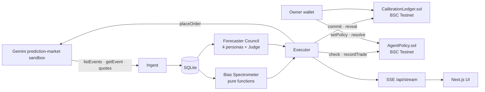

# CASSANDRA

*Cassandra was always right and never believed. Now she has a ledger.*

A proof-of-calibration network for prediction markets. A council of adversarial AI forecasters seals its probability
on-chain before an event resolves, a deterministic Bias Spectrometer names the cognitive biases distorting the live
price, and a policy-bound agent wallet trades the gap in the Gemini prediction-market sandbox.

**Live:** [cassandra-amber.vercel.app](https://cassandra-amber.vercel.app) · engine
[cassandra-engine.fly.dev/api/capabilities](https://cassandra-engine.fly.dev/api/capabilities)


> **Chain status: local anvil, not BSC Testnet yet.** Every commit, reveal, policy check, `TradeRecorded` and
> `Scored` is a real transaction, but on an anvil chain (id 31337) running beside the engine, because no free faucet
> would drip tBNB to a fresh wallet (see [docs/CUTS.md](docs/CUTS.md)). The UI badges every chain value "local chain".
> `pnpm deploy:testnet` moves it to BSC Testnet (chain 97) in one command once the owner wallet
> `0x96B259daae8666f7CD4848fB6B3DB9BD4f044a6c` holds ≥ 0.005 tBNB.

## What it does

1. **Names the bias.** Not "the market is wrong" but "this price carries 1.4 points of overround; here is the
   arithmetic." Five pure detectors run over stored order-book ticks.
2. **Argues before it speaks.** The Actuary, the Decomposer, the Skeptic and the Reporter stream their cases; a Judge
   pools them in logit space. The whole debate is hashed into the on-chain commitment.
3. **Proves calibration.** Commit, reveal, then a Brier score on resolution. Anyone can check she was right before it
   was obvious.
4. **Stays on a leash.** The owner sets spend limits in `AgentPolicy`; the agent cannot record a trade outside them,
   and each trade is logged beside its Gemini order id.

## Architecture



Details in [docs/ARCHITECTURE.md](docs/ARCHITECTURE.md).

## Why this isn't hard-coded

**Recompute a commitment.** `GET /api/markets/:symbol` returns each commit's `marketKey`, `pBps`, `reasoningHash` and
`salt` once revealed. `GET /api/forecasts/:id` returns the personas and Judge JSON.

```ts
import { keccak256, toBytes, encodeAbiParameters } from "viem";
const f = await (await fetch(`${ENGINE}/api/forecasts/${id}`)).json();
keccak256(toBytes(canonicalJson({ personas: f.personas, judge: f.judge })));   // === reasoningHash
keccak256(encodeAbiParameters(
  [{ type: "bytes32" }, { type: "uint16" }, { type: "bytes32" }, { type: "bytes32" }],
  [keccak256(toBytes(symbol)), pBps, reasoningHash, salt]));                     // === on-chain commitment
```

`canonicalJson` (sorted keys, no whitespace) is in `packages/shared/src/hash.ts`. The Ledger's **verify** button runs
exactly this in the browser.

**Recompute a bias score.** `GET /api/markets/:symbol` returns the raw ticks and the latest report. Every signature
carries its `evidence`. Overround on a binary contract: `sum = yesAsk + noAsk`, `score = clamp((sum − 1.02) / 0.10)`.
Composite: `irrationality = 100 × (1 − Π(1 − wₖ·scoreₖ))` with the weights in `packages/shared/src/bias/index.ts`.
`pnpm --filter @cassandra/shared test` runs a firing and a null test for every detector.

**Fixtures never leak.** With `DRY_RUN_*` set or a key missing, `/api/capabilities` says so and the UI paints an amber
"fixture" or "dry-run" badge on every affected number. Without an LLM key the council refuses to forecast.

## Setup

Node 22.4+, pnpm 9, Foundry.

```bash
pnpm install
cp .env.example .env           # Gemini sandbox keys, ANTHROPIC_API_KEY, OWNER/AGENT private keys, CHAIN_NETWORK
anvil &                        # only for CHAIN_NETWORK=local
pnpm deploy:local              # or: pnpm deploy:testnet (needs tBNB on the owner wallet)
pnpm dev                       # web :3000, engine :4000
pnpm smoke                     # capability table, discovery, bias, council, seal, policy, order
pnpm demo:replay               # score settled sandbox markets on-chain for the Ledger
```

Deploy: `fly deploy` (engine + anvil, state on a volume; see `fly.toml`) and `vercel deploy --prod` (web, root `apps/web`,
`NEXT_PUBLIC_ENGINE_URL` set to the engine).

## Deployments

| | Local chain (31337, live demo) | BSC Testnet (97) |
| --- | --- | --- |
| CalibrationLedger | `0x0b339ee0a3dcda7ebc1c07d15da966f586dbad54` | pending tBNB |
| AgentPolicy | `0x0b23d823f330f459523b9b2beca21dc8e21a93f3` | pending tBNB |
| Agent | `0xB87A941e1316f03Bb0802463Dd7eC26FDf85177B` | same |
| Owner / resolver | `0x96B259daae8666f7CD4848fB6B3DB9BD4f044a6c` | same |

Real Gemini sandbox order: `145853902277221008` (visible in the sandbox order history).

## What we build next

- **Gemini settlement attestations as the resolver.** Today the owner wallet resolves; production reads signed
  settlement from the exchange so nobody grades their own forecaster.
- **Reputation staking for forecasters.** Stake behind your Brier score; slash on miscalibration.
- **An open forecaster registry.** Any agent can commit to the ledger; capital allocators follow the calibrated ones.
- **Reveal at resolution.** The demo reveals immediately; production reveals at settlement so a strong forecaster
  cannot be copy-traded.
