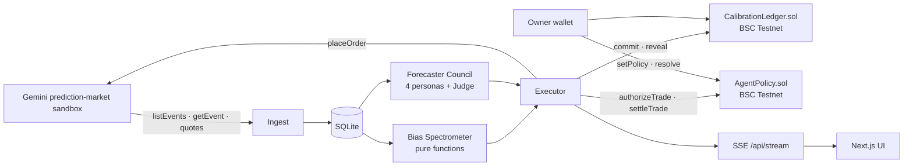

# Architecture

Two services, one shared package, one contracts package, SQLite on disk, SSE for realtime.

| Path | What it is |
| --- | --- |
| `apps/engine` | Fastify on Node 22. Ingest, bias, council, executor, chain client, REST + SSE on :4000 |
| `apps/web` | Next.js App Router. Field `/`, Dossier `/m/[symbol]`, Ledger `/ledger`, Leash `/policy` on :3000 |
| `packages/shared` | zod schemas, the Bias Spectrometer (pure functions + vitest), commitment hashing, contract ABIs |
| `packages/contracts` | Foundry: `CalibrationLedger.sol`, `AgentPolicy.sol`, `Deploy.s.sol`, forge tests |
| `fixtures/gemini` | Real sandbox responses captured by `pnpm capture`, served only when `DRY_RUN_GEMINI=true` |

## Data flow per tick

1. **Ingest** polls each tracked contract's order book every 5 s (`marketData.getCurrentOrderBook`), converts decimal
   strings to integer basis points at the adapter boundary, and stores a `tick`.
2. **Bias Spectrometer** (`packages/shared/src/bias`) runs five pure detectors over the last 24 h of ticks:
   overround, favorite-longshot, round-number anchoring, herding, recency shock. Composite
   `irrationality = 100 × (1 − Π(1 − wₖ·scoreₖ))`.
3. **Council** runs when irrationality ≥ 35, the last forecast is over 60 min old, or on `POST /api/run/:symbol`.
   Four personas stream in parallel (`streamObject`, 350 output tokens each); the Judge pools them in logit space
   (`generateObject`). Cached by `(symbol, mid rounded to 0.05, hour bucket)`, capped by `COUNCIL_MAX_RUNS_PER_HOUR`.
4. **Seal**: `commitment = keccak256(abi.encode(marketKey, pBps, reasoningHash, salt))` with
   `reasoningHash = keccak256(canonicalJson({ personas, judge }))`. `commit()` from the agent wallet, then `reveal()`.
5. **Policy**: `AgentPolicy.check(agent, notionalCents, edgeBps, category)` as an `eth_call`. Refusals stop here and are
   stored with the contract's reason string.
6. **Trade**: IOC limit order in the Gemini sandbox at best ask + 1 tick. The attempt row is written *before*
   `placeOrder`; mutations are never retried; status is reconciled from `getOrderHistory`.
7. **Authorize, order, settle**: the agent calls `authorizeTrade(marketKey, notional, edgeBps, category, keccak256(clientOrderId))`; a revert stores the trade as refused and no order is sent. `gateway.placeAuthorized(txHash)` re-reads `TradeAuthorized` from the receipt, checks market, notional and clientOrderId against the stored row (unique `onchain_trade_id`), and only then places the IOC order with that clientOrderId. `settleTrade(tradeId, keccak256(orderId), filledNotional)` refunds the unfilled part of the reservation and emits `TradeRecorded`. The
   contract re-checks policy and reverts `PolicyViolation(reason)` if the leash was tightened in between.
8. **Resolve** every 10 min: settled Gemini contracts → owner calls `resolve(marketKey, outcomeYes)` → `Scored` events.

Every chain write is stored `pending → confirmed | failed` in `chain_txs`; on boot pending rows are reconciled by
receipt lookup and never resent.

## Realtime

`GET /api/stream` emits typed JSON events (`tick`, `bias.update`, `council.start|delta|persona|final|error`,
`seal.pending|committed|revealed|scored`, `policy.checked`, `trade.placed|recorded|refused`, `policy.updated`,
`index.update`, `block`, `log`). The web app uses `EventSource` and REST for initial loads.

## Dry-run paths

Each adapter reports `live` or `fixture`/`dry-run` at `GET /api/capabilities` and the UI badges every affected number.
Without an LLM key the council refuses to run rather than invent a forecast.
